<h1 align="center">専門医症例カウンター</h1>

  放射線科専門医・診断専門医・治療専門医の申請に必要な症例数を数えて、 
  <strong>学会が配布している研修手帳の様式（Excel）に書き込んで出力する</strong>、無料のWebアプリです。

  <a href="#はじめかた個人で使う"><strong>▶ 個人で使う（3分）</strong></a>
  　｜　
  <a href="#複数人で使う科内同期の管理者向け"><strong>▶ 複数人で使う（管理者向け）</strong></a>
  　｜　
  <a href="docs/usage.md"><strong>使い方ガイド</strong></a>

  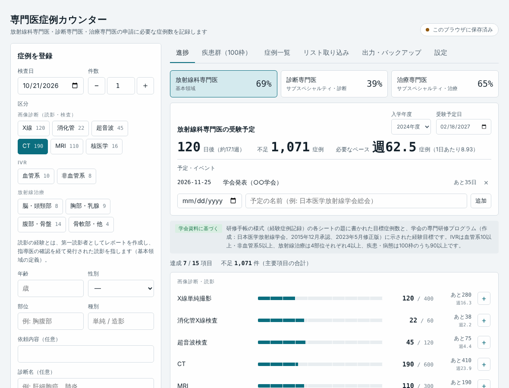

進捗の画面。画面は、すべて架空のデモデータです。

> [!NOTE]
> **非公式のツールです。** 学会・機構とは関係ありません。目標の件数は、学会の資料（研修手帳・研修プログラム）をもとにした初期値で、画面からいつでも直せます。**提出する前に、出力されたExcelの内容と、最新の受験要項を、必ずご自身で確認してください。**

---

## このアプリでできること

|  | できること |
|---|---|
| 📝 **症例を数える** | 検査日・区分・年齢・性別・診断名などを、1件ずつ登録します。スマートフォンからも使えます。**患者ID・氏名・生年月日は、入力欄そのものがありません** |
| 📊 **進捗が分かる** | 3つの専門医ごとに、達成状況・不足件数・**受験日までに必要なペース（週あたり）** を表示します。疾患群の100枠も、タップして割り当てられます |
| 📥 **まとめて取り込む** | 読影レポートの一覧（CSV・Excel）から、必要な列だけを自動で取り込みます。**患者情報の列は読み込みません** |
| 📤 **研修手帳に書き込む** | 配布されている**様式のExcelに、そのまま書き込んで**出力します。書式・結合セル・入力規則は、元のままです。**3種類**（基本領域・診断・治療）に対応しています |
| 👥 **複数人で管理する** | 科内・同期の全員の進捗を、管理者が一覧で見られます（Googleスプレッドシート＋Apps Script。Googleサイトにも埋め込めます） |

> [!IMPORTANT]
> **学会・機構の様式ファイル（Excel）は、このアプリには入っていません。** 使う人が、自分で配布元から入手した様式のファイルを、アプリの画面で選びます。[詳しくは「様式ファイル（Excel）について」](#様式ファイルexcelについて)

---

## どれを使えばいい？

使い方は2通りです。**迷ったら、まず「個人で使う」から始めてください。** あとから、バックアップを使って引っ越せます。

|  | 🙋 **個人で使う** | 👥 **複数人で使う** |
|---|---|---|
| こんな人向け | 自分の症例だけ数えたい | 科内・研修施設・同期の症例数を、まとめて見たい（管理者） |
| 準備 | **なし**（ファイルを開くだけ） | Googleアカウント＋セットアップ（30〜40分、コピー＆貼り付けだけ） |
| データの場所 | **自分のブラウザの中だけ** | 管理者のGoogleドライブのスプレッドシート |
| 費用 | 無料 | 無料 |
| 管理者の画面 | なし | 全員の進捗の一覧、入学年度での絞り込み、メンバー管理 |
| 手順 | [▶ はじめかた](#はじめかた個人で使う) | [▶ セットアップ手順](docs/apps-script-setup.md) |

---

## はじめかた（個人で使う）

準備は要りません。次の6ステップで使い始められます。

### ステップ 1　アプリを開く

次の**どちらか**です。

- **A. URLから開く**（かんたん）：<https://ringnir.github.io/radiology-case-counter/>
  - 開けないときは、方法Bで使ってください（公開の設定がまだのときがあります）
- **B. ファイルを開く**：このページの緑の **「Code」ボタン → 「Download ZIP」** を押して、ZIPを解凍し、中の **`index.html`** をダブルクリックします（ブラウザで開きます。インターネットにつながっていなくても動きます）

> [!TIP]
> データは、**開いたURL（またはファイル）とブラウザごと**に別々に保存されます。A と B、スマホとパソコンは、別のデータになります。どれで使うか、最初に決めてください（引っ越しは、[バックアップ](#バックアップを忘れずに)でできます）。

### ステップ 2　様式のExcelを選ぶ

画面上の **「出力・バックアップ」タブ** を開き、**「様式ファイルを選ぶ」** を押して、学会・機構が配布している様式のExcelを選びます。

  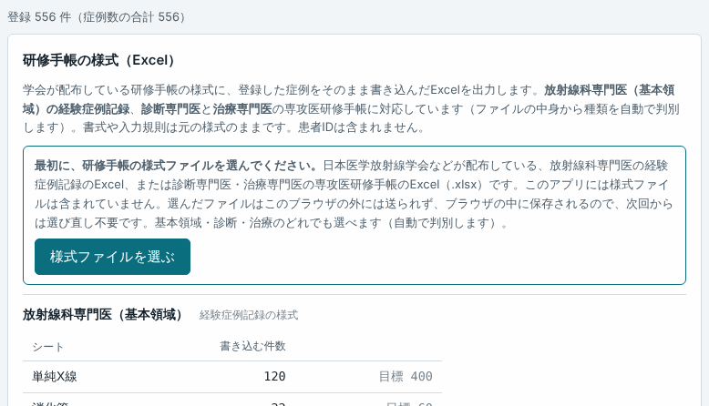

- 出したい専門医の分だけ、選びます（基本領域・診断・治療のどれでも。**ファイルの中身から、自動で見分けます**）
- 一度選べば、**そのブラウザに保存されます**（次回から、選び直す必要はありません）
- **選んだファイルは、外部には送られません**（あなたのブラウザの中だけで使います）
- 様式への出力を使わない（件数を数えるだけ）なら、このステップは**飛ばせます**

### ステップ 3　最初の設定をする

**「設定」タブ**で、次を入れます。入力すると、その場で自動保存されます。

| 項目 | 例 |
|---|---|
| 入学年度 | 2024年度 |
| 自分の氏名・指導医の氏名 | 研修手帳の「第一読影者」「確定者（指導医）」の欄に、既定で入ります |
| 研修施設 | 施設名と、9桁の施設コード（診断・治療の手帳では「施設番号」も） |

  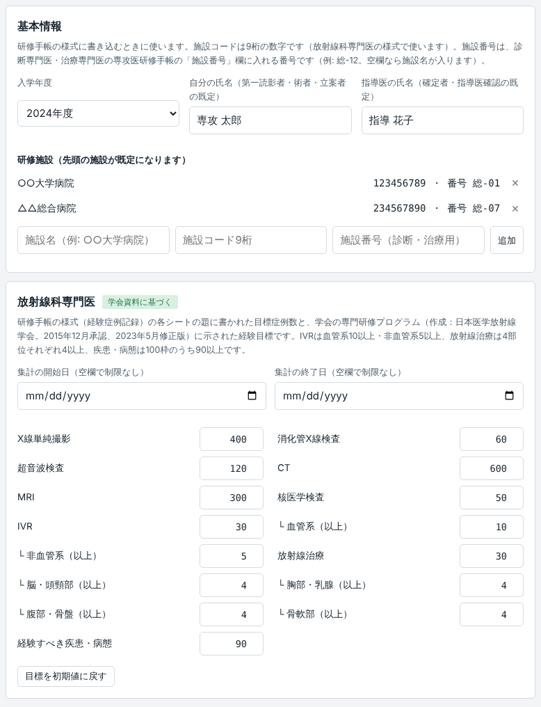

「各専門医の目標値と集計期間」は、学会の資料をもとにした初期値が入っています（根拠は[こちら](docs/sources.md)）。違うところは、画面から直せます。

### ステップ 4　症例を登録する

画面左のフォームで、**1件ずつ**登録します。検査日・区分（CT・MRIなど）・年齢・性別・診断名を入れて、「登録」を押すだけです。

<table align="center">
  <tr>
    <td align="center">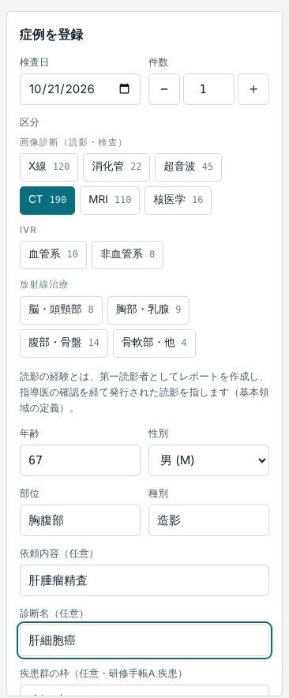 画像診断（CT・MRIなど）</td>
    <td align="center">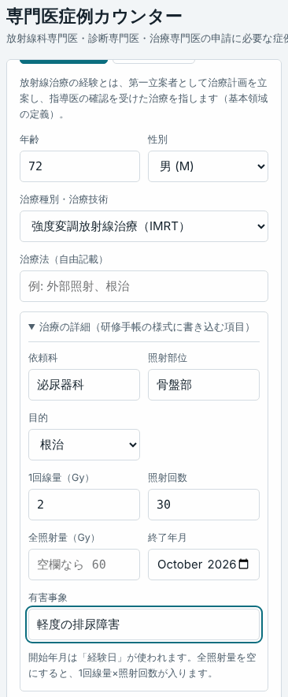 放射線治療（治療の詳細も入れられます）</td>
  </tr>
</table>

- 過去のぶんは、レポートの一覧から[まとめて取り込めます](docs/usage.md#6-過去の分をまとめて取り込む)
- **患者さんの氏名・ID・生年月日は、入れないでください**（入力欄もありません）

### ステップ 5　進捗を見る

**「進捗」タブ**で、専門医ごとの達成状況と、**あと何件必要か**が分かります。「入学年度」と「受験予定日」を入れると、**受験までの日数と、必要なペース（週あたり）** も出ます。各項目の「＋」を押すと、その区分の登録フォームに移れます。

  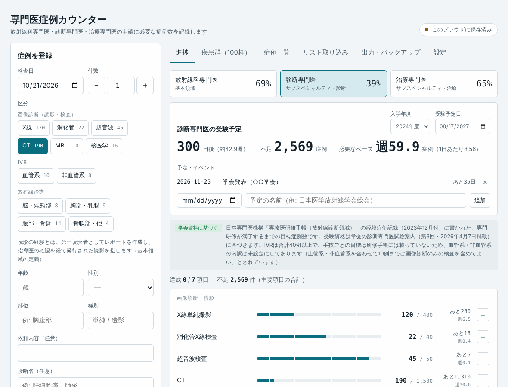

### ステップ 6　様式に書き込んで出力する

**「出力・バックアップ」タブ**で、書き込まれる件数を確認して、**「…の様式に書き込んで出力」** を押します。ダウンロードされたExcelを開いて、内容を確認してください。

  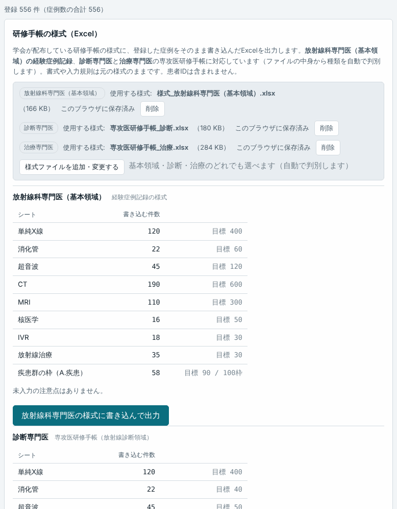

> [!WARNING]
> **提出する前に、出力されたExcelを、必ずご自身の目で確認してください。** 提出先の記載ルール・確認欄・署名は、提出先の指示に従ってください。[確認するところの一覧](docs/usage.md#出力されたファイルを必ず確認する)

### バックアップを忘れずに

個人で使うデータは、**ブラウザの中にだけ**あります。ブラウザの閲覧データを消すと、記録も消えます。**月に1回くらい、「出力・バックアップ」タブの「バックアップを保存」** を押して、ファイル（JSON）を残してください。端末やブラウザを変えるときは、「バックアップから復元」で引き継げます。

---

## 複数人で使う（科内・同期の管理者向け）

メンバーが各自の氏名とパスコードで登録し、**管理者が全員の進捗を一覧で見られる**版です。メンバーはGoogleアカウントが要らず、URLを開くだけで使えます。

  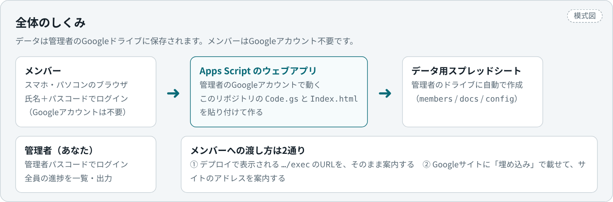

- **管理者がやること**：Googleのスクリプト置き場（Apps Script）に、このリポジトリのファイル2つをコピー＆貼り付けして、公開（デプロイ）する。**はじめてなら30〜40分**。プログラミングの知識は要りません
- **メンバーがやること**：管理者から教わったURLを開いて、招待コードで新規登録する
- 画面つきで、**1画面ずつ解説した手順書**があります

| 読むもの | 内容 |
|---|---|
| ▶ **[セットアップ手順](docs/apps-script-setup.md)** | 手順0〜7を、画面の図つきで。各手順に「確認」と「うまくいかないとき」があります |
| ▶ **[運用・更新・困ったとき](docs/apps-script-admin.md)** | メンバーへの案内文、管理者の画面の使い方、バックアップ、更新のしかた、エラー別の対処表 |

  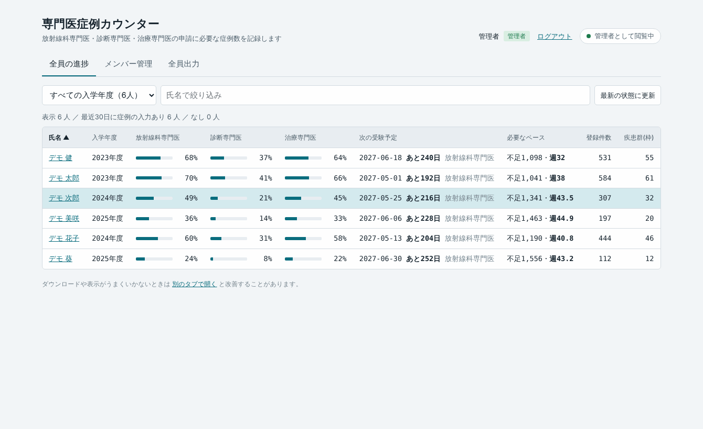

> [!WARNING]
> 管理者パスコードと招待コードは、`Code.gs` に**書き込む値**です。**書き換えた `Code.gs` を、公開しないでください**（このリポジトリの `Code.gs` は空欄です）。また、症例のデータを院外のクラウド（Google）に置いてよいか、**所属施設の規程を確認**してください。

---

## 画面の紹介

<strong>疾患群（100枠）</strong>：研修手帳「A.疾患」の100枠を、タップして割り当てる

 

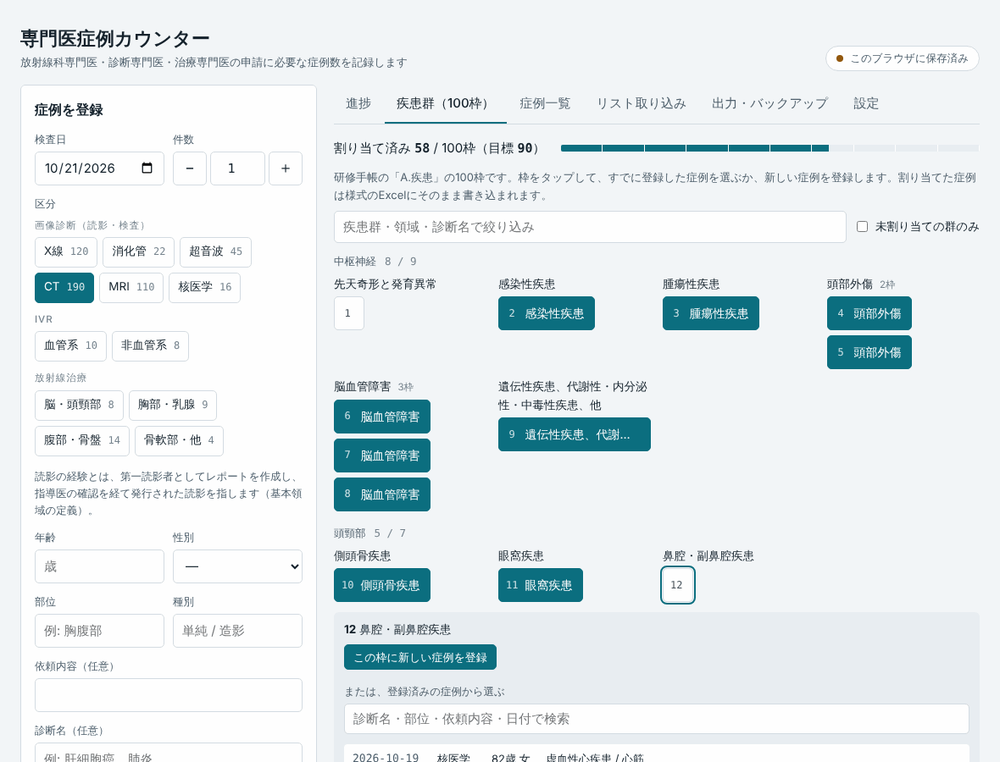

<strong>症例一覧</strong>：登録した症例の検索・編集・削除

 

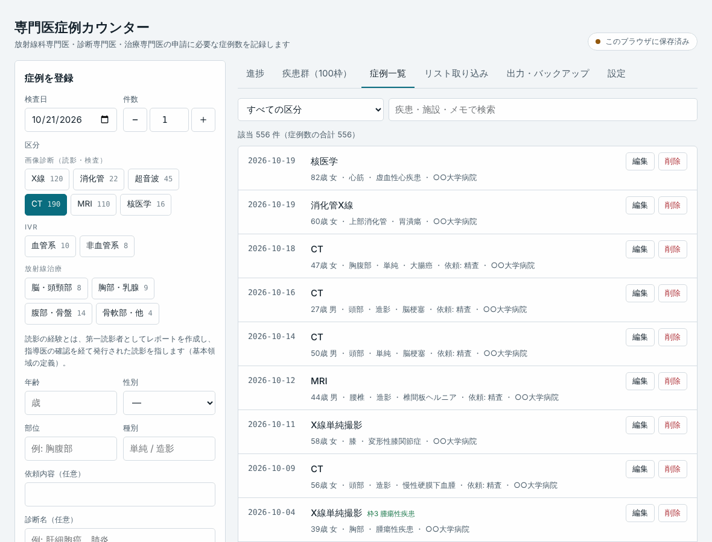

<strong>リスト取り込み</strong>：レポート一覧（CSV・Excel）から、必要な列だけを取り込む

 

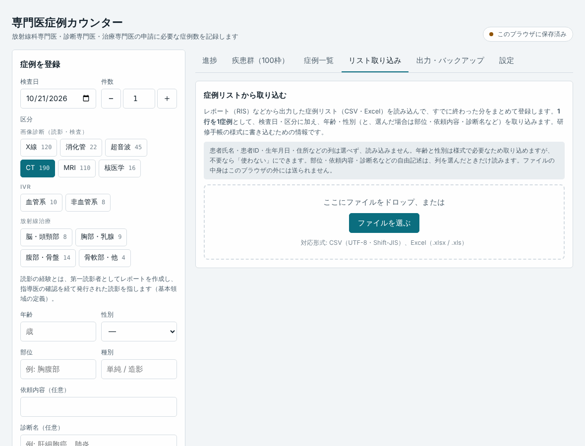

<strong>スマートフォンの画面</strong>：登録・進捗・出力

 
<table align="center">
  <tr>
    <td align="center">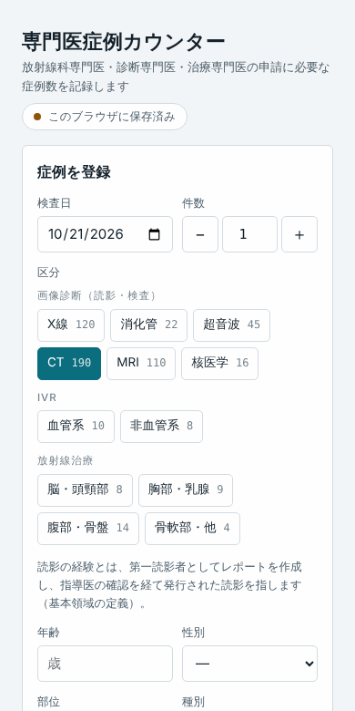 登録</td>
    <td align="center">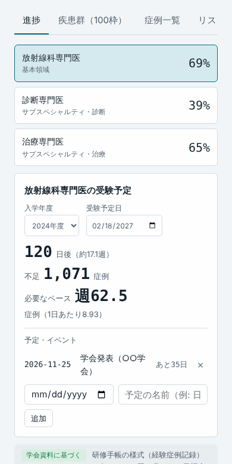 進捗</td>
    <td align="center">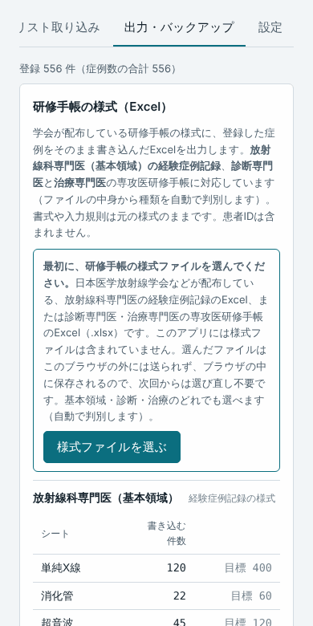 出力</td>
  </tr>
</table>

画面の見かたと、各機能の詳しい使い方は、**[使い方ガイド](docs/usage.md)** にあります。

---

## 様式ファイル（Excel）について

- **このリポジトリ・配布ファイル（`index.html`、`apps-script/` など）には、学会・機構の様式ファイルは含まれません。** 学会・機構が配布している様式の権利は、配布元に帰属します。使う人が、自分で入手したファイルを、ブラウザで選んで使います
- アプリに入っているのは、100枠の番号・疾患群名・領域名など、**様式の構造（データ）だけ**です
- **選んだ様式は、あなたのブラウザの中（IndexedDB）に保存されるだけで、外部には送られません**（複数人で使う版でも、サーバーには送りません）
- 対応している様式は、次の**3種類**です。どれを選んでも、中身から自動で判別します

| 専門医 | 選ぶ様式 | 書き込まれるシート |
|---|---|---|
| 放射線科専門医（基本領域） | 経験症例記録 | A.疾患（100枠）、B.検査（単純X線・消化管・超音波・CT・MRI・核医学）、IVR、放射線治療 |
| 診断専門医 | 専攻医研修手帳（放射線診断領域） | B.単純・消化管・超音波・CT・MRI・核医学、C.IVR（目標が様式の行数を超える分は、行を自動で追加） |
| 治療専門医 | 専攻医研修手帳（放射線治療領域） | A.部位別4シートと、B.治療技術4シート（部位別と技術別は、重複して書き込み） |

- 読み込み時に、想定している様式かを確認します。違うファイルは、理由を表示して受け付けません
- **様式のバージョンが変わったとき**は、アプリ側の更新が必要です（[開発者向けの資料](docs/development.md#様式のバージョンが変わったとき)）

---

## 個人情報の扱い

- **患者ID・患者氏名・生年月日の入力欄はありません。** 取り込み画面でも、これらの列は選べず、読み込みません
- 診断名・依頼内容などの自由記述は、メールアドレス・ID様の数字列・「○○様」などを取り除いて保存します。それでも、**個人が特定できる内容は書かないでください**
- 出力するExcelに、患者IDは含まれません
- 個人で使う版のデータは、**あなたのブラウザの中だけ**にあります（サーバーには送られません）。複数人で使う版は、管理者のGoogleドライブに保存されます（[安全面と制限](docs/apps-script-admin.md#安全面と制限)）

---

## よくある質問

<strong>データが消えました／別の端末でも使いたい</strong>

 
個人で使う版のデータは、<strong>そのブラウザの中だけ</strong>にあります。閲覧データを消した、別のURLやブラウザで開いた、シークレットモードで使った、などのときは、見えなくなります。「バックアップを保存」で残したファイルがあれば、「バックアップから復元」で戻せます。

<strong>様式のExcelは、どこで手に入れますか</strong>

 
学会・機構が配布している、研修手帳の様式です。所属する研修プログラムの案内や、学会・機構の公式の配布ページを確認してください。このアプリでは配布できません。

<strong>様式を選んでも受け付けられません</strong>

 
理由が画面に出ます。配布されている様式を、加工せずに選んでください（シート名を変えた・見出しを書き換えた・版が違う、などのときは受け付けません）。診断・治療は、それぞれの専攻医研修手帳が必要です。

<strong>目標の件数が、学会の基準と違います</strong>

 
「設定」タブで、項目ごとに直せます。初期値は学会の資料をもとにしていますが、基準は改訂されることがあります。<strong>申請の前に、最新の研修手帳・整備基準で確認してください</strong>。<a href="docs/sources.md">根拠にした資料</a>

<strong>スマートフォンでも使えますか</strong>

 
使えます。登録・進捗・出力のすべてが、スマホの画面に合わせて並びます。様式への出力は、パソコンのほうが確認しやすいです。

その他の質問は、[使い方ガイドのよくある質問](docs/usage.md#よくある質問)へ。

---

## ドキュメント一覧

| 資料 | 対象 | 内容 |
|---|---|---|
| [使い方ガイド](docs/usage.md) | みんな | 画面の見かた、症例の登録、取り込み、進捗、様式への出力、よくある質問 |
| [複数人で使う：セットアップ手順](docs/apps-script-setup.md) | 管理者 | Googleスプレッドシート＋Apps Script の導入を、画面の図つきで |
| [複数人で使う：運用・更新・困ったとき](docs/apps-script-admin.md) | 管理者 | メンバーへの案内文、バックアップ、更新、安全面、エラー別の対処 |
| [根拠にした資料](docs/sources.md) | みんな | 目標症例数・受験要件の出典 |
| [GitHubでの公開・更新](docs/github.md) | リポジトリの持ち主 | GitHub Pages での公開、更新、フォーク |
| [開発者向けの資料](docs/development.md) | 開発者 | ビルド、テスト、構成、様式の構造定義の作り直し |

---

## 不具合・要望

[Issues](https://github.com/ringnir/radiology-case-counter/issues) に書いてください（**患者さんの情報・パスコード・招待コードは、書かないでください**）。

## ライセンス

[MIT License](LICENSE)。自由に使用・改変・再配布できます。無保証です。症例数の集計や出力の誤りによる不利益について、作者は責任を負いません。

同梱の JSZip（`vendor/`）は MIT または GPLv3 の二重ライセンスで、MIT を選んで使用しています。学会の研修手帳の様式（xlsx）は含まれず、その権利は配布元の学会・機構に帰属します。
