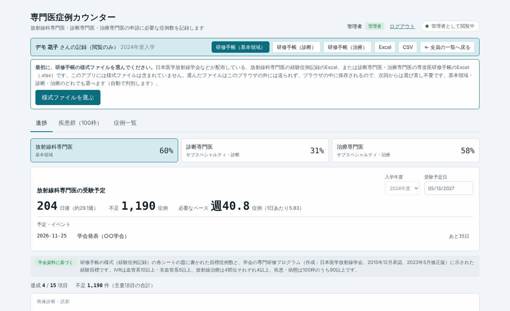
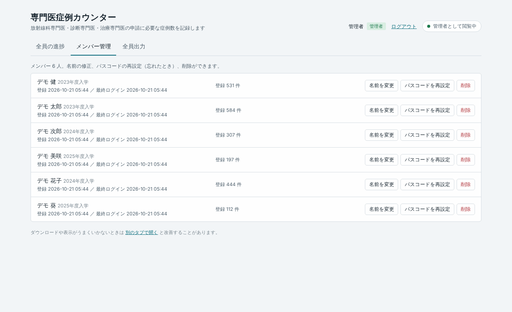
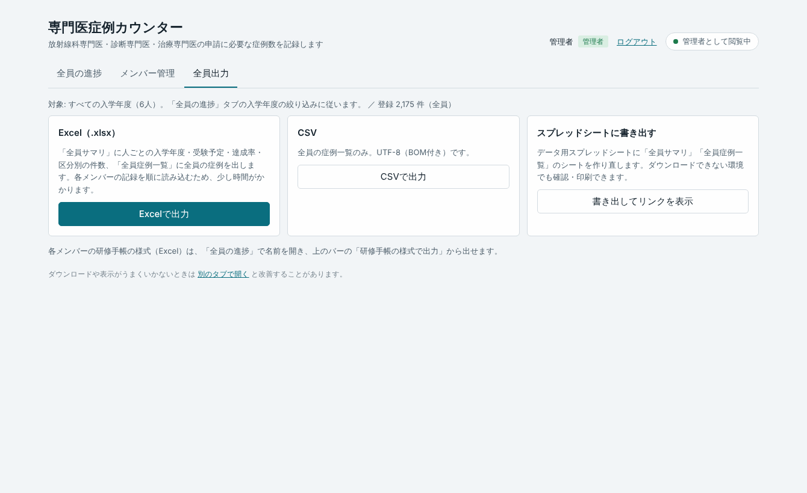
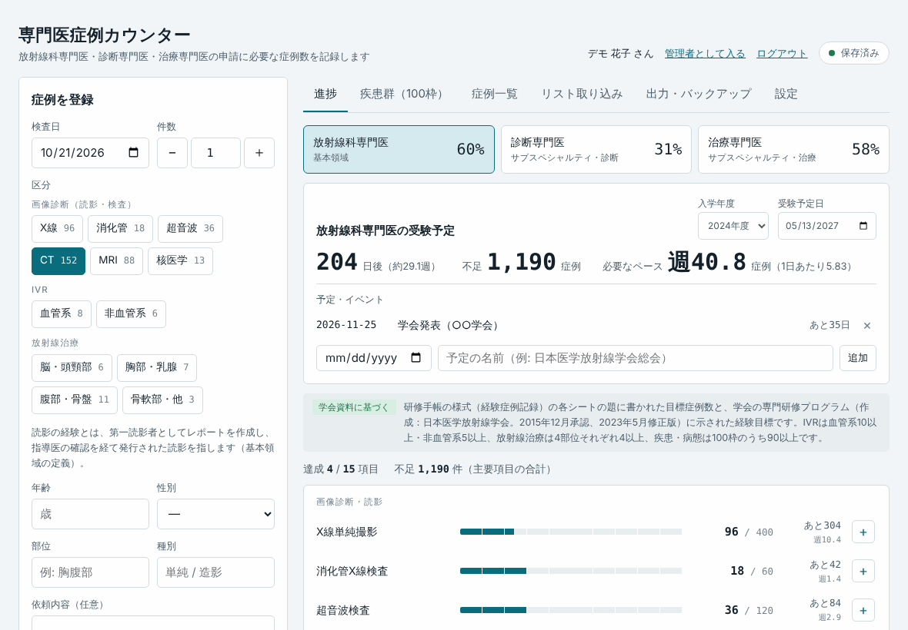
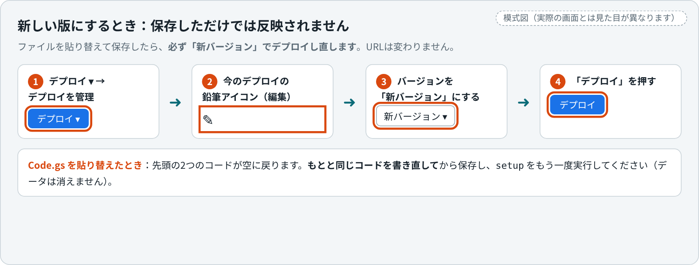

# 複数人で使う：運用・更新・困ったとき

[セットアップ手順](apps-script-setup.md)が終わったあとの、**管理者向けの資料**です。メンバーへの案内文、管理者の画面の使い方、バックアップ、新しい版への更新、安全面、エラー別の対処表をまとめています。

## 目次

- [メンバーへの案内](#メンバーへの案内)
- [管理者の画面の使い方](#管理者の画面の使い方)
- [日々の運用](#日々の運用)
- [バックアップ](#バックアップ)
- [管理者を交代するとき](#管理者を交代するとき)
- [新しい版に更新するとき](#新しい版に更新するとき)
- [安全面と制限](#安全面と制限)
- [困ったとき](#困ったとき)
- [学会の様式の扱い](#学会の様式の扱い)

---

## メンバーへの案内

次の文面を、メールやチャットでメンバーに送ってください（【　】は書き換え）。

```
症例カウンターを使えるようにしました。

アドレス：【セットアップ手順5のURL、または Googleサイトのアドレス】
初回は「新規登録」から、次の3つを入力して登録してください。
 ・氏名（管理者に表示されます。本名で）
 ・パスコード（6文字以上。自分で決めて、忘れないように）
 ・招待コード：【　　　　】

登録したあとは、「ログイン」から氏名とパスコードで入れます（スマホ・PCどちらも同じ）。
症例を登録するときは、患者ID・患者氏名・生年月日は入れないでください。
診断名などの自由記述にも、個人が特定できる内容は書かないでください。
「設定」で入学年度と受験予定日を入れておくと、残り日数が出ます。
様式（研修手帳）への書き込みを使うときは、学会・機構が配布している様式のExcelを、
「出力・バックアップ」タブで一度選んでください（アプリには様式は入っていません）。
パスコードを忘れたときは、管理者に連絡してください。
詳しい使い方：https://github.com/ringnir/radiology-case-counter/blob/main/docs/usage.md
```

- 招待コードは、**メンバーになる人にだけ**伝えてください（掲示板などに載せない）
- メンバー向けのやさしい使い方は、**[使い方ガイド](usage.md)** です。リンクを一緒に送ると、問い合わせが減ります

---

## 管理者の画面の使い方

ログイン画面の **「管理者」** タブに、管理者パスコードを入れると入れます。メンバーとして登録している人は、メンバー画面の **「管理者として入る」** から、管理者パスコードを入れて切り替えることもできます（メンバー画面にも戻れます）。

### 全員の進捗

全員の進捗（3つの専門医）、入学年度、受験予定日、残り日数、不足件数、週あたりのペースを一覧で見られます。入学年度での絞り込み、並べ替え、氏名の検索ができます。

<p align="center"></p>

氏名を押すと、そのメンバーの記録を**閲覧のみ**で開き、研修手帳の様式（基本領域・診断・治療の3種類）・Excel・CSVで出力できます。**管理者が、他のメンバーの記録を書き換えることはできません。**

<p align="center"></p>

### メンバー管理

氏名の変更、**パスコードの再設定**、メンバーの削除ができます（削除は2段階の確認があります。記録も消えます）。

<p align="center"></p>

### 全員出力

全員分を、Excel（集計＋症例一覧）・CSVで保存できます。「スプレッドシートに書き出す」を押すと、データ用スプレッドシートに `全員サマリ`・`全員症例一覧` のシートができて、そのURLが開けます（確認・印刷用）。

<p align="center"></p>

### メンバーの画面（参考）

メンバーがログインすると、自分の記録だけが見える、次のような画面になります。

<p align="center"></p>

> 画面の人名・症例は、すべて架空のデモデータです。

---

## 日々の運用

### メンバーの追加・削除・パスコードの再設定

| やりたいこと | 方法 |
|---|---|
| **追加** | 招待コードを伝えて、本人に「新規登録」してもらう（管理者が代わりに登録する機能はありません） |
| **パスコードを忘れたとき** | 管理者画面の「メンバー管理」で、そのメンバーのパスコードを再設定して、新しいパスコードを本人に伝える。メンバー本人は、ログイン後の「設定」でパスコードを変えられます |
| **氏名の表記を直したいとき** | 「メンバー管理」で氏名を変更する（同じ氏名は登録できません。全角・半角、スペースの有無、大文字小文字の違いは、同じ氏名として扱います） |
| **卒業・退会** | 必要なら先に「全員出力」で保存してから、「メンバー管理」で削除する |

### 毎年の使い回し

データを消さずに、そのまま使い続けられます。

1. 新しい年度の人に、招待コードを案内して登録してもらう
2. 各自に、「設定」で**入学年度**と**受験予定日**を入れてもらう
3. 管理者画面の「全員の進捗」で、**入学年度で絞り込んで**見る

招待コードを年度ごとに変えたいときは、`Code.gs` の `JOIN_CODE` を書き換えて、[新しい版に更新するとき](#新しい版に更新するとき)の手順5（新バージョンのデプロイ）をします。すでに登録済みのメンバーには影響しません。

---

## バックアップ

- **データ用スプレッドシートのコピー**：ドライブでスプレッドシートを開き、「ファイル → コピーを作成」で、ときどき（月1回など）コピーを残す。「ファイル → 変更履歴」でも、以前の状態を見られます
- **各自のバックアップ**：メンバーには、「出力・バックアップ」タブの「バックアップを保存」（JSON）を、ときどき保存してもらう
- **データ用スプレッドシートを消さない・中身を直接書き換えない**：誤って削除すると、`setup` を実行したときに空のスプレッドシートが新しく作られ、以前のデータにはつながらなくなります（ゴミ箱に残っている間なら戻せます）

---

## 管理者を交代するとき

データは、**管理者のGoogleアカウントのドライブ**にあります。アカウントがなくなると、データも、URLも使えなくなります。異動や退職の前に、次の準備をしてください。

1. 「全員出力」で、全員の記録をExcelで保存する
2. 各メンバーに、「バックアップを保存」（JSON）を保存してもらう
3. 新しい管理者が、[セットアップ手順](apps-script-setup.md)の手順0〜7で、**新しく作る**（新しいURLができます）
4. メンバーに、新しいURLと招待コードを案内して、新規登録してもらい、各自のバックアップを「バックアップから復元」で戻してもらう

---

## 新しい版に更新するとき

アプリが新しくなったときの手順です。**URLは変わりません。** 変わったファイルだけ差し替えます（どちらが変わったか分からなければ、両方を差し替えます）。

<p align="center"></p>

**やること**

1. 新しいZIPをダウンロードして解凍する（[手順0](apps-script-setup.md#手順0-ファイルを手元に用意する)）
2. Apps Script のエディタを開く（<https://script.google.com> の「マイプロジェクト」から、作ったプロジェクトを開く）
3. 変わったファイルの中身を、**すべて選択して削除し、新しい内容を貼り付けて**、保存する
   - `Index.html`：画面の変更。**これだけ差し替えれば足りることがほとんどです**
   - `Code.gs`：サーバー側の変更。**置き換えると、先頭の2つのコードが空に戻ります。** 管理者パスコードと招待コードを、**もとと同じものに書き直して**から保存してください（別のものにしたい場合を除く）。書き直さずにデプロイすると、「初期設定が終わっていません」と表示されます
4. `Code.gs` を差し替えた場合は、関数 `setup` をもう一度実行する（データは消えません）
5. **「デプロイ」→「デプロイを管理」→ 鉛筆アイコン →「バージョン」を「新バージョン」にして →「デプロイ」** を押す（**保存しただけでは、メンバーが使っているURLには反映されません**）

**確認**

- 「デプロイを管理」の画面で、バージョンの番号が、前より1つ増えている
- シークレットウィンドウで、URLを開き直して（再読み込みも）、変更が反映されている。管理者パスコードでログインできる

2つのコードは、自分が分かる場所（パスワード管理ツールなど）にも控えておくと、更新のときに楽です。

---

## 安全面と制限

### 誰が何を見られるか

| 誰が | 見られるもの |
|---|---|
| メンバー本人 | 自分の記録だけ |
| 管理者（管理者パスコードを知っている人） | 全員の記録（閲覧のみ） |
| **スクリプトの持ち主（管理者のGoogleアカウント）** | **すべて。** データ用スプレッドシートを直接開けば、全員の症例が読めます。`Code.gs` には2つのコードが平文で書いてあります |

- **データ用スプレッドシートを、他の人に共有しないでください**（共有すると、全員分の症例が読めてしまいます）。`Code.gs`（スクリプト）の編集権限も、渡さないでください
- メンバーのパスコードは、塩（ソルト）つきのSHA-256のハッシュでシートに保存され、管理者にも元のパスコードは分かりません（管理者にできるのは「再設定」だけ）
- URLを知っていれば、誰でもログイン画面は開けます。中に入るには、招待コード（新規登録）か、氏名とパスコード（ログイン）が必要です。ログイン（氏名ごと）・招待コード・管理者パスコードは、それぞれ5回続けて間違えると、15分ほど入力できなくなります
- ログイン状態は30日続きます

### 患者さんの情報について

このアプリは、患者ID・患者氏名・生年月日の入力欄を持たず、レポート一覧の取り込みでもそれらの列を読みません。それでも、年齢・性別・検査日・診断名などの組み合わせは、状況によっては個人が推定されることがあります。**症例の情報を院外のクラウドに置くこと自体が、所属施設の規程で制限されている場合があります。** 使い始める前に、所属施設の情報セキュリティ・倫理の担当に確認してください。

### 上限・目安

- 数十人規模を想定しています
- 登録できるメンバーは500人まで
- 1人・1か月あたり、約64万文字（数千件）まで保存できます
- 同時に保存する人が多いと、「混み合っています」と出ることがあります（少し待って、もう一度）
- Googleの無料アカウントには、1日あたりの使用量の上限があります。上限に達すると、「Service invoked too many times」などのエラーが出て、しばらく（24時間以内に）使えなくなります。数十人が日常的に症例を登録する使い方では、ふつう問題になりませんが、多くの人が一斉に使う場面（例：説明会で全員が同時に登録）は避けると安心です

---

## 困ったとき

### アプリを開いたときの表示

| 症状・表示 | 原因と対処 |
|---|---|
| 「管理者の初期設定（管理者パスコードと招待コードの設定）がまだ終わっていません。」 | `Code.gs` の2つのコードが空、または短い（管理者パスコード8文字以上、招待コード6文字以上）。直して保存し、**新バージョンでデプロイ**する（[手順5](apps-script-setup.md#手順5-ウェブアプリとしてデプロイする)、または[更新手順](#新しい版に更新するとき)の5） |
| 「管理者の初期設定（setup の実行）がまだ終わっていません。」 | `setup` を実行していない。[手順4](apps-script-setup.md#手順4-setup-を実行してデータ置き場を作る)をやる |
| 「ファイルを開くことができません」といった表示（アドレスを確認してください、と続きます） | ① URLが `/exec` か確認。② 「デプロイを管理」で、**「アクセスできるユーザー」が「全員」**になっているか確認。③ **複数のGoogleアカウントでログインしている**と、この表示になることがあります。シークレットウィンドウで開く、またはほかのアカウントからログアウトして試す |
| 「スクリプト関数が見つかりません: doGet」 | `Code.gs` の貼り付けに失敗している。[手順2](apps-script-setup.md#手順2-codegs-を貼り付けて2つのコードを設定する)をやり直し、**新バージョンでデプロイ**する |
| 「HTMLファイル Index が見つからない」という趣旨のエラー | `Index.html` のファイル名が違う。ファイル一覧の名前が、`Index`（先頭だけ大文字、拡張子は `.html`）になっているか確認（[手順3](apps-script-setup.md#手順3-indexhtml-を追加して貼り付ける)） |
| 真っ白なページ・読み込みが終わらない | 少し待つ（初回は遅いことがあります）。再読み込み。それでも変わらないときは、ブラウザの拡張機能（広告ブロックなど）をオフにするか、シークレットウィンドウで試す |
| コードを直したのに、画面が変わらない | `/exec` のURLは、デプロイした時点の版を動かします。**「デプロイを管理」で新バージョンにする**（[更新手順](#新しい版に更新するとき)の5） |

### ログイン・登録

| 症状・表示 | 原因と対処 |
|---|---|
| 管理者でログインできない | 管理者パスコードが `Code.gs` と一致しているか（**空白や全角が入っていないか**）。`Code.gs` を直したあと、**新バージョンでデプロイ**したか |
| 「招待コードが違います。」 | メンバーが入力した招待コードが、`Code.gs` の `JOIN_CODE` と違う（前後の空白は無視されます）。`Code.gs` を直したあとは、新バージョンでデプロイ |
| 「失敗が続いたため、15分ほど入力できません。」 | 5回続けて間違えたため。15分待てば自動で解除されます（氏名ごと・招待コード・管理者パスコードで、それぞれ数えます） |
| 「その氏名はすでに登録されています。」 | 同じ氏名（全角半角・スペース・大文字小文字の違いは同じ）がすでにある。ログインするか、表記を変える |
| メンバーがパスコードを忘れた | 管理者画面の「メンバー管理」で再設定する |
| 管理者パスコード・招待コードを忘れた | `Code.gs` の先頭に書いてあるので、エディタで確認する |
| 管理者パスコードを変えたい／全員を強制ログアウトしたい | 管理者パスコードは `Code.gs` を書き換えて、新バージョンでデプロイ。ただし、**すでにログインしている人（管理者含む）は最長30日そのまま入れます。** すぐにログアウトさせたい場合は、エディタ左の「プロジェクトの設定」（歯車）→ 下の「スクリプト プロパティ」で **`SECRET` を削除**し、関数 `setup` を実行する（新しい `SECRET` ができ、全員がログインし直しになります。データは消えません） |

### 保存・出力

| 症状・表示 | 原因と対処 |
|---|---|
| 「混み合っています。少し待ってから…」 | 同時に使っている人が多い。少し待って、もう一度 |
| 「データが大きすぎて保存できません。」 | 1人・1か月あたりの上限（約64万文字）を超えた。ふつうは起きません。件数を2以上にした「件数だけの記録」にまとめるなどして減らす |
| ダウンロードできない／毎回ログインや様式の選び直しが必要 | 埋め込み画面では、ブラウザの制限で起きることがある。画面の一番下の **「別のタブで開く」** から使う |
| 症例が消えた、おかしい | まず、データ用スプレッドシートの「ファイル → 変更履歴」で以前の状態を探す。メンバーが保存していたバックアップ（JSON）からも、アプリの「バックアップから復元」で戻せる |

### Google側の画面

| 症状・表示 | 原因と対処 |
|---|---|
| 承認画面で「このアプリは Google で確認されていません」 | 自分で作ったスクリプトなので正常です。「詳細」→「（プロジェクト名）（安全ではないページ）に移動」 |
| 承認画面が開かない | ポップアップがブロックされています。許可してから、もう一度やる |
| 「アクセスできるユーザー」に「全員」がない | 組織のGoogleアカウントの制限です（[手順5](apps-script-setup.md#手順5-ウェブアプリとしてデプロイする)の「うまくいかないとき」を参照） |
| `Service invoked too many times` | 1日あたりの使用量の上限に達した。24時間ほど待つと戻ります |
| Googleサイトで、真っ白・拒否された | URLが `/exec` か、「アクセスできるユーザー」が「全員」になっているか確認（手順5）。**組織のGoogleアカウントでは、外部への公開が制限されていることがあります** |

それでも解決しないときは、次の情報を添えて、リポジトリの [Issues](https://github.com/ringnir/radiology-case-counter/issues) に書いてください（**パスコードや招待コード、個人情報は書かないでください**）。

- どの手順で、どんな表示が出たか
- ブラウザの種類
- 個人のGoogleアカウントか、組織のアカウントか

---

## 学会の様式の扱い

- このアプリ（`apps-script/Index.html` を含む）には、**学会・機構の様式ファイルは含まれていません**（ライセンス上、配布物に同梱しないことにしています）。様式への書き込み出力を使う人は、アプリの「出力・バックアップ」タブで、**学会・機構が配布している様式のExcel（.xlsx）を各自で選びます**
- **放射線科専門医（基本領域）・診断専門医・治療専門医の3種類**に対応しており、ファイルの中身から自動で判別します。一度選ぶとブラウザに保存されます（埋め込み画面などでは保存されず、そのつど選び直しになることがあります）
- 管理者がメンバーの記録を開いたときも、様式の出力には、管理者のブラウザで様式を選ぶ必要があります（画面上部に選択欄が出ます）。3種類の出力ボタンが並びます
- 様式のExcelは、**ブラウザの中だけで処理されます**。サーバー（Apps Script）には送られません
