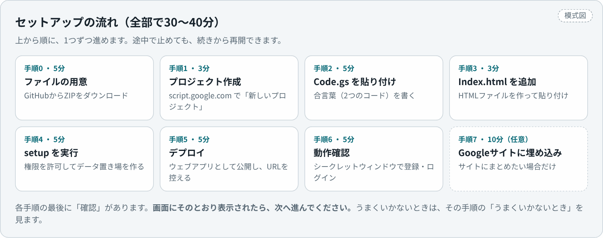
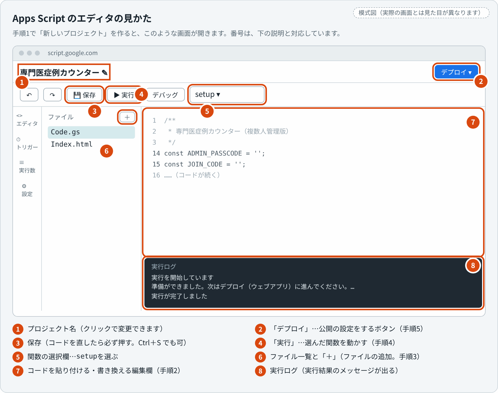
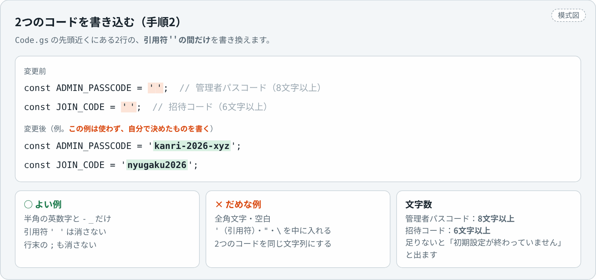
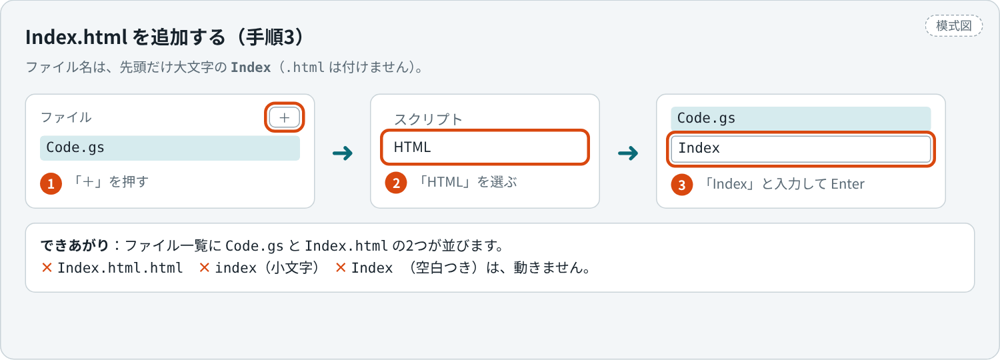
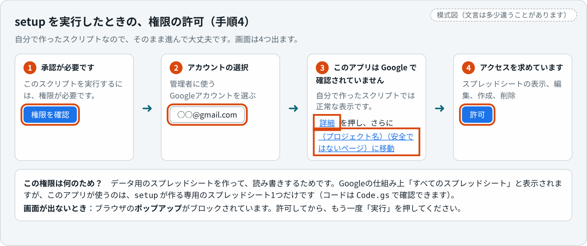
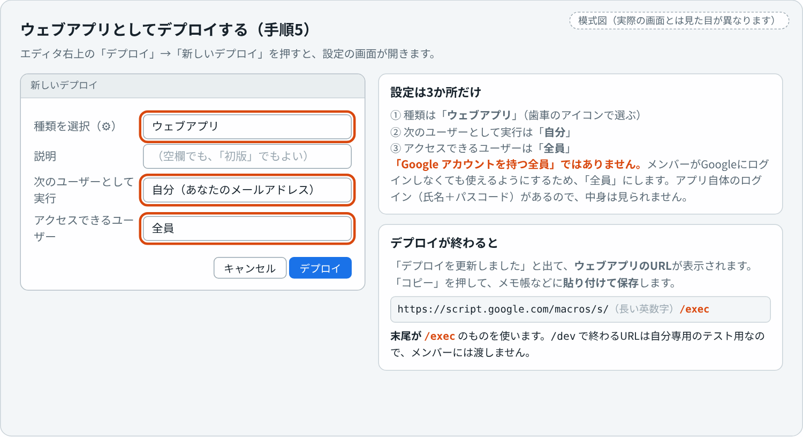
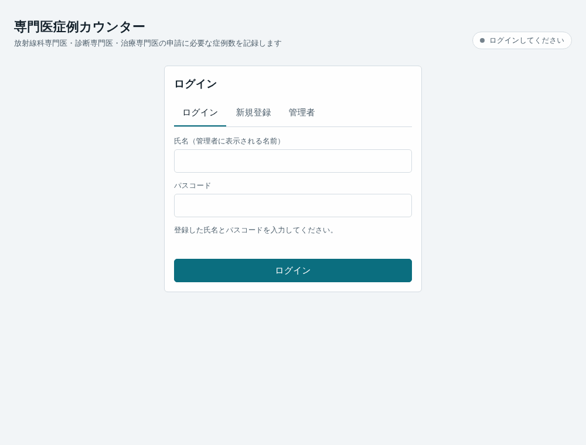
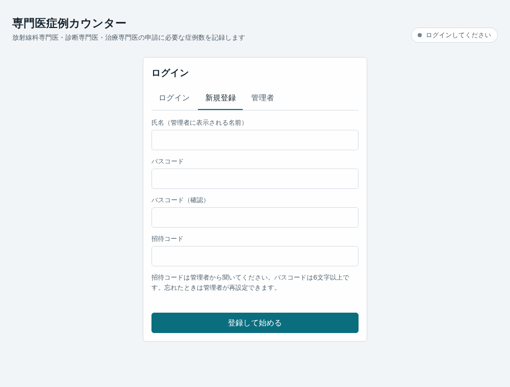
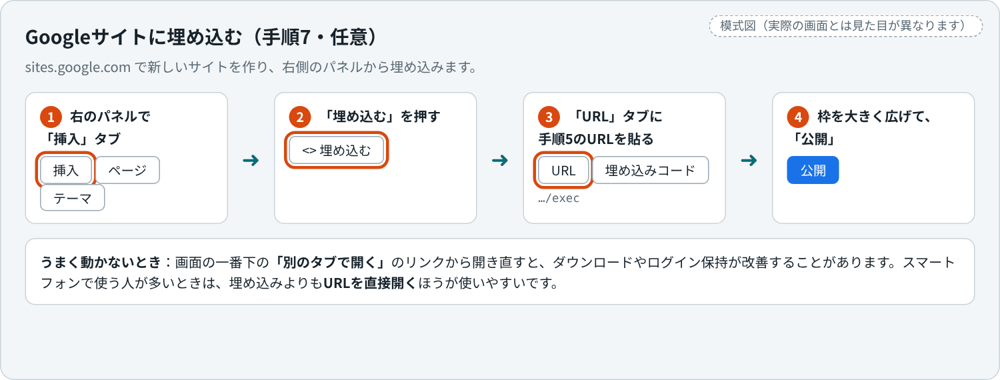

# 複数人で使う：セットアップ手順（Googleスプレッドシート ＋ Apps Script）

科内・研修施設・同期など、**複数人の症例数をまとめて管理したい人（管理者）向けの手順**です。プログラミングの知識は要りません。ファイルの中身を**コピーして貼り付ける**だけで作れます。

| | |
|---|---|
| 所要時間 | はじめてなら **30〜40分** |
| 必要なもの | パソコン、Googleアカウント（管理者用）、決めておく2つの合言葉 |
| メンバー側 | URLを開いて登録するだけ。**Googleアカウントは不要**です |
| 費用 | 無料（Googleの無料アカウントで動きます） |

<p align="center"></p>

> [!NOTE]
> 画面の名称や並びは、Google側の更新で少し変わることがあります。名前が少し違っても、同じ意味のボタン・メニューを探してください。この手順は、パソコンの **Google Chrome** で操作することを前提にしています。

---

## 目次

- [はじめに読んでください](#はじめに読んでください)
- [手順0. ファイルを手元に用意する](#手順0-ファイルを手元に用意する)
- [手順1. Apps Script のプロジェクトを作る](#手順1-apps-script-のプロジェクトを作る)
- [手順2. Code.gs を貼り付けて、2つのコードを設定する](#手順2-codegs-を貼り付けて2つのコードを設定する)
- [手順3. Index.html を追加して貼り付ける](#手順3-indexhtml-を追加して貼り付ける)
- [手順4. setup を実行してデータ置き場を作る](#手順4-setup-を実行してデータ置き場を作る)
- [手順5. ウェブアプリとしてデプロイする](#手順5-ウェブアプリとしてデプロイする)
- [手順6. 動作を確認する](#手順6-動作を確認する)
- [手順7. Googleサイトに埋め込む（任意）](#手順7-googleサイトに埋め込む任意)
- [公開前のチェックリスト](#公開前のチェックリスト)

運用・更新・トラブル対応は、別の資料 **[運用・更新・困ったとき](apps-script-admin.md)** にまとめました。

---

## はじめに読んでください

### 全体の流れ

<p align="center"></p>

### この手順書の読み方

各手順は、次の3つの見出しで書いてあります。

- **やること**：画面で操作することを、順番に書いています
- **確認**：うまくいっていれば、画面にこう表示されます。**そのとおりに表示されたら、次の手順に進んでください**
- **うまくいかないとき**：よくあるつまずきと、その直し方です

途中で作業を止めても構いません。続きは、そのまま次の手順から再開できます。

### 先に決めておくこと：2つの合言葉

| 名前 | 使いみち | 文字数 |
|---|---|---|
| **管理者パスコード** | 管理者としてログインするための合言葉 | **8文字以上** |
| **招待コード** | メンバーが新規登録するときの合言葉（メンバーにだけ伝える） | **6文字以上** |

決めるときのルールです。

- 2つは**別の文字列**にします。ほかのサービスのパスワードの使い回しは避けてください
- 使える文字は、**半角の英数字と `-`（ハイフン）・`_`（アンダースコア）だけ**にしてください。`'`・`"`・`\`・空白・全角文字は、あとで動かなくなる原因になります
- 例：管理者パスコード `kanri-2026-xyz`、招待コード `nyugaku2026`（**この例はそのまま使わず、自分で決めてください**）
- 決めたら、パスワード管理ツールなど、**自分だけが見られる場所に控えて**ください。更新のときに、もう一度書く必要があります

### 使う前に確認すること

- **Googleアカウント**は、管理者用に、**長く使い続けられるもの**を使います。異動・退職でなくなるアカウントだと、データごと失われます
- 大学・病院の**組織のGoogleアカウント**は、外部への公開が禁止されていて、手順5で詰まることがあります。その場合は、個人のGoogleアカウントで作るか、組織の管理者に確認してください
- 症例のデータを院外のクラウド（Google）に置いてよいか、**所属施設の規程**を確認してください（[運用・更新・困ったとき](apps-script-admin.md#患者さんの情報について)）

<details>
<summary>用語の説明（分からない言葉が出てきたら開いてください）</summary>

| 言葉 | 意味 |
|---|---|
| Apps Script | Googleが提供している、スプレッドシートなどを動かす小さなプログラムの置き場所。このアプリのサーバー側はここで動きます |
| プロジェクト | Apps Script の中の、ひとまとまりのプログラム（この手順では `Code.gs` と `Index.html` の2ファイル） |
| ウェブアプリ・デプロイ | プログラムを、URLで開けるWebページとして公開すること。**コードを書き換えても、デプロイし直すまで、URLの中身は変わりません** |
| 実行ログ | エディタの下に出る、プログラムの実行結果のメッセージ |
| `setup` | データ用スプレッドシートを作るための関数。最初に1回、エディタから実行する |

</details>

---

## 手順0. ファイルを手元に用意する

**やること**

1. このリポジトリのトップ（[github.com/ringnir/radiology-case-counter](https://github.com/ringnir/radiology-case-counter)）で、緑の **「Code」ボタン → 「Download ZIP」** を押す
2. ダウンロードしたZIPを解凍する（ダブルクリック、または右クリック →「すべて展開」）
3. 解凍してできたフォルダの中の **`apps-script` フォルダ**を開く

**確認**

- `apps-script` フォルダに、**`Code.gs`** と **`Index.html`** の2つのファイルがある
- この2つを、**メモ帳（Windows）やテキストエディット（Mac）などのテキストエディタ**で開ける

> [!TIP]
> `Index.html` をダブルクリックするとブラウザが開いてしまいます。それは違うので、**右クリック →「プログラムから開く」** で、テキストエディタを選んでください。Macのテキストエディットは、「フォーマット → 標準テキストにする」にしてから開きます。

**うまくいかないとき**

- `Code.gs` を開くアプリが分からない：拡張子 `.gs` に、アプリが関連づけられていないだけです。「プログラムから開く」で、メモ帳（テキストエディット）を選んでください
- 文字化けして読めない：文字コードをUTF-8にしてください（Windowsのメモ帳なら、開くときに「エンコード：UTF-8」を選びます）

---

## 手順1. Apps Script のプロジェクトを作る

**やること**

1. ブラウザの右上のアイコンで、**管理者に使うGoogleアカウントでログインしている**ことを確認する（複数のアカウントでログインしているときは、管理者用のアカウントに切り替えるか、**Chromeのプロフィールを分ける**と、取り違えを防げます）
2. **<https://script.google.com>** を開く
3. 左上の **「新しいプロジェクト」** を押す
4. エディタが開いたら、左上の「無題のプロジェクト」をクリックして、わかりやすい名前（例：`専門医症例カウンター`）に変えて「名前を変更」を押す

**確認**

エディタが開き、次のような画面になっている（**次の図で、各部分の名前を覚えておくと、以降の手順が楽になります**）。

<p align="center"></p>

- 左のファイル一覧に、**`Code.gs`** が1つだけある
- 編集欄に `function myFunction() { }` と書いてある

**うまくいかないとき**

- 「新しいプロジェクト」が見つからない：<https://script.new> を開くと、新しいプロジェクトが作られます
- 「Apps Script を利用できません」と出る：組織のGoogleアカウントで、管理者が Apps Script を止めていることがあります。個人のGoogleアカウントで作ってください

---

## 手順2. Code.gs を貼り付けて、2つのコードを設定する

**やること**

1. 手元の `apps-script/Code.gs` を、テキストエディタで開き、**中身をすべて選択してコピー**する（Ctrl＋A → Ctrl＋C。Macは ⌘＋A → ⌘＋C）
2. Apps Script のエディタに戻り、左のファイル一覧で **`Code.gs`** をクリックする
3. 編集欄をクリックして、中身を**すべて選択して削除**する（Ctrl＋A → Delete）
4. コピーした内容を**貼り付ける**（Ctrl＋V。Macは ⌘＋V）
5. 先頭近くにある、次の2行を探す（編集欄の中で Ctrl＋F を押して `ADMIN_PASSCODE` と入力すると、すぐ見つかります）

   ```js
   const ADMIN_PASSCODE = '';   // 管理者パスコード（8文字以上）
   const JOIN_CODE = '';        // 招待コード（メンバーが新規登録するときの合言葉・6文字以上）
   ```

6. 引用符 `' '` の**間に**、決めておいたコードを書く

   <p align="center"></p>

7. **保存**する（Ctrl＋S。Macは ⌘＋S。または、上のフロッピーディスクのアイコン）

**確認**

- ファイルの一番上が `/**` で始まり、「専門医症例カウンター（複数人管理版） サーバー側コード」という説明が見える
- 2行に、自分で決めたコードが入っていて、引用符で囲まれている
- ファイルの一番下まで行くと、`}` で終わっている（最後まで貼り付けられている）
- 保存したあと、上のバーに「保存中…」「保存しました」のような表示が出る

**うまくいかないとき**

- 貼り付けたら、元の `function myFunction() {}` が残ってしまった：貼り付ける前の「中身をすべて選択して削除」をしていません。もう一度、すべて選択して削除してから貼り付けてください
- 引用符を消してしまった・全角にしてしまった：2行を、図のとおりに直してください
- 管理者パスコードは8文字以上、招待コードは6文字以上です。足りないと、あとで「初期設定が終わっていません」と表示されます

> [!WARNING]
> **このコードを書き込んだ `Code.gs` は、GitHubなどに載せないでください。** 2つのコードは、ファイルの中に書かれます。

---

## 手順3. Index.html を追加して貼り付ける

**やること**

1. 左のファイル一覧の上にある **「ファイルを追加」（＋のアイコン）→ 「HTML」** を選ぶ
2. ファイル名を入力する欄が出るので、**`Index`** と入力して Enter（**`.html` は付けない**。先頭だけ大文字で、`Index` とそのとおりに）

   <p align="center"></p>

3. 新しくできたファイルが開く。**中身には最初から数行のHTMLが入っているので、すべて選択して削除**する
4. 手元の `apps-script/Index.html` を、テキストエディタで開き、**中身をすべてコピー**して、ここに**貼り付ける**（約300KBあり、貼り付けに数秒かかります。固まったように見えても、少し待ってください）
5. 保存する（Ctrl＋S）

**確認**

- 左のファイル一覧に、**`Code.gs` と `Index.html` の2つ**が並んでいる（`Index.html.html` や `index.html` ではない）
- `Index.html` の一番下が、`</html>` で終わっている

**うまくいかないとき**

- ファイル名を間違えた：ファイル名の右の「︙」→「名前を変更」で、`Index` に直せます（拡張子は自動で付きます）
- 貼り付けに失敗して、途中で切れている：すべて削除して、もう一度コピーし直してください。コピーするときは、必ず **Ctrl＋A で全選択してから**コピーします

---

## 手順4. setup を実行してデータ置き場を作る

`setup` は、データを保存するスプレッドシートを自動で作る関数です。**最初に1回だけ**実行します。

**やること**

1. エディタ上部の関数の選択欄（「デバッグ」ボタンの右。初めは `myFunction` などと出ている）を押して、**`setup`** を選ぶ
2. **「実行」** を押す
3. 初回は **「承認が必要です」** と出るので、次の4つの画面を順に進める

   <p align="center"></p>

   1. 「権限を確認」を押す（別のウィンドウが開きます）
   2. 管理者用の**Googleアカウント**を選ぶ
   3. 「このアプリは Google で確認されていません」と出たら、**「詳細」→「（プロジェクト名）（安全ではないページ）に移動」** を押す。これは、**自分で作ったスクリプトがGoogleの審査を受けていない**ために出る、通常の表示です
   4. 「スプレッドシートの表示、編集、作成、削除」の権限を求められるので、**「許可」** を押す
4. 許可すると、自動で実行されます。されなかったときは、もう一度「実行」を押す

**確認**

- 画面の下の **「実行ログ」** に、次のように表示される（文言は、多少違うことがあります）

  ```
  実行を開始しています
  準備ができました。次はデプロイ（ウェブアプリ）に進んでください。データ保存先: https://docs.google.com/spreadsheets/d/…
  実行が完了しました
  ```

- Googleドライブ（<https://drive.google.com>）の「マイドライブ」に、**`専門医症例カウンター_データ（直接編集しないでください）`** というスプレッドシートができている。開くと、下のタブに **`members`・`docs`・`config`** の3つのシートがある（中身は、今は見出しの行だけ）

**うまくいかないとき**

| 表示 | 原因と対処 |
|---|---|
| 「先に、このファイル上部の ADMIN_PASSCODE と JOIN_CODE を書き換えてから、もう一度 setup を実行してください。」 | 手順2の設定が足りません。2つのコードを書き（管理者パスコード8文字以上、招待コード6文字以上）、**保存してから**、もう一度 `setup` を実行する。スプレッドシートは、すでに作られています（作り直されません） |
| 実行ログが出ない／「実行」を押しても何も起きない | 関数の選択欄が `setup` になっていますか。画面の下の「実行ログ」の欄が、閉じていないか確認してください |
| `ReferenceError` や `SyntaxError`（構文エラー）と赤く出る | `Code.gs` が最後まで貼り付けられていない、または、コードを書くときに引用符などを消してしまっています。手順2をやり直してください |
| 承認の画面が出ない | ブラウザの**ポップアップ**がブロックされています。許可してから、もう一度「実行」 |
| 承認のあと「このアプリはブロックされました」と出る | 組織のGoogleアカウントで、管理者が許可していないことがあります。個人のGoogleアカウントで作るか、組織の管理者に確認してください |

`setup` は、何度実行しても、すでにあるデータは消えません。

---

## 手順5. ウェブアプリとしてデプロイする

「デプロイ」は、プログラムを**URLで開けるWebページとして公開する**ことです。

**やること**

1. エディタ右上の **「デプロイ」→「新しいデプロイ」** を押す
2. 「種類を選択」の横の**歯車アイコンを押して、「ウェブアプリ」** を選ぶ
3. 次のように設定する

   <p align="center"></p>

   | 項目 | 設定 |
   |---|---|
   | 説明 | 空欄でも、`初版` などでもよい |
   | 次のユーザーとして実行 | **自分（管理者のメールアドレス）** |
   | アクセスできるユーザー | **全員** |

   「全員」にするのは、メンバーがGoogleにログインしなくても使えるようにするためです。アプリ自体のログイン（氏名＋パスコード）があるので、パスコードなしでは中身は見られません。**「Google アカウントを持つ全員」ではなく、「全員」** を選んでください

4. **「デプロイ」** を押す（承認を求められたら、手順4と同じ流れで許可）
5. 「デプロイを更新しました」と出て、**「ウェブアプリ」のURL**が表示される。**「コピー」を押して、メモ帳などに貼り付けて保存**しておく
6. 「完了」を押す

**確認**

- コピーしたURLが、**`https://script.google.com/macros/s/` で始まり、`/exec` で終わっている**
- あとでURLを確認したいときは、「デプロイ」→「デプロイを管理」で、もう一度見られます

**うまくいかないとき**

- 「アクセスできるユーザー」に **「全員」の選択肢がない**：組織（大学・病院）のGoogleアカウントで、管理者が外部への公開を禁止している可能性が高いです。次のどれかにしてください
  - **個人のGoogleアカウントで、手順1からやり直す**（おすすめ）
  - 組織のGoogle管理者に、「Apps Script のウェブアプリを、組織外にも公開したい」と相談する
  - メンバー全員が、同じ組織のGoogleアカウントでログインできる場合に限り、「（組織名）内の全員」でも使えることがあります。ただしその場合、メンバーはGoogleにログインした状態で開く必要があります（複数のアカウントでログインしていると、開けないことがあります）
- 「デプロイをテスト」にも URL が出る：そちらは `/dev` で終わる**自分専用のテスト用URL**です。メンバーには渡さないでください。メンバーに渡すのは、必ず `/exec` のURLです

---

## 手順6. 動作を確認する

**必ず、実際に1回通して試してください。** ここで確認しておくと、メンバーに案内したあとのトラブルを防げます。

**やること**

1. Chromeの**シークレットウィンドウ**（Ctrl＋Shift＋N。Macは ⌘＋Shift＋N）を開き、コピーしたURLを開く（Googleにログインしていない人が開いたときと同じ状態で、確認できます）
2. **ログイン画面**が出る

   <p align="center"></p>

3. 上のタブで **「管理者」** を選び、管理者パスコードを入れてログインする → 「全員の進捗」の画面になる（まだ0人です）
4. いったんログアウトし、**「新規登録」** で、テスト用の氏名・パスコード（6文字以上）・招待コードを入れて登録する

   <p align="center"></p>

5. 症例を1件登録して、右上の表示が **「保存済み」** になることを確認する
6. もう一度ログアウトして、**「管理者」** でログイン → 一覧に、テスト用のメンバーが出ていることを確認する

   <p align="center"></p>

7. その氏名を押して、記録が閲覧のみで開くことを確認する
8. 「メンバー管理」で、テスト用のメンバーを削除する（確認が2段階で出ます）
9. （できれば）**スマートフォン**でも、同じURLを開いて、ログインできることを確認する

**確認**

| 場面 | 見えるはずのもの |
|---|---|
| URLを開く | 「専門医症例カウンター」のログイン画面（最初は、読み込みに少し時間がかかることがあります。画面の上に、Googleのアプリであることの注意書きが出ることがありますが、正常です） |
| 管理者でログイン | 「全員の進捗」の画面 |
| 新規登録 | 登録後、そのままメンバーの画面に入る |
| 症例を登録 | 右上が「保存中…」→「保存済み」 |
| データ用スプレッドシートを開く | `members` に、テスト用の氏名の行が1行できている（氏名・ハッシュ化されたパスコードなど。元のパスコードは書かれていません） |

**うまくいかないとき**

| 症状 | 見るところ |
|---|---|
| ログイン画面ではなく、エラーの文字が出る | [困ったとき](apps-script-admin.md#困ったとき)の「アプリを開いたときの表示」 |
| 「ファイルを開くことができません」 | URLが `/exec` か、「アクセスできるユーザー」が「全員」か |
| 管理者でログインできない | 管理者パスコードが `Code.gs` と同じか。コードを直したなら、**新しいバージョンでデプロイし直した**か |

---

## 手順7. Googleサイトに埋め込む（任意）

Googleサイトに載せなくても、手順5のURLをメンバーに伝えれば使えます。サイトにまとめたい場合の手順です。**スマートフォンで使う人が多いときは、埋め込みよりも、URLを直接開くほうが使いやすいです。**

**やること**

1. <https://sites.google.com> で、新しいサイトを作る（または、既存のサイトを開く）。**新しい Google サイト**を使います（旧 Google サイトは対象外です）
2. 右側のパネルの **「挿入」タブ → 「埋め込む」** を押す
3. **「URL」タブ**に、手順5のURL（`…/exec`）を貼り付けて「次へ」→ プレビューが出たら **「挿入」**
4. 埋め込まれた枠の角をドラッグして、**大きく広げる**（横いっぱい、縦は画面いっぱい以上がおすすめ）
5. 右上の **「公開」** を押して、サイトのアドレスを決めて公開する

<p align="center"></p>

**確認**

- サイトのプレビュー（上の目のアイコン）で、ログイン画面が表示される
- 公開したアドレスを、**シークレットウィンドウで開いて**、ログインできる

> [!IMPORTANT]
> **公開範囲（誰がサイトを見られるか）は、Googleサイト側の設定です。** メンバー以外に見せたくないときは、サイトの共有設定で制限してください。ただし、**サイトを制限しても、手順5のURLを直接知っている人は、アプリのログイン画面までは開けます**（中に入るには、招待コードか、氏名とパスコードが必要です）。URLは、メンバー以外に広めないでください。

**埋め込みのときの注意（ブラウザや設定によります）**

- ダウンロード（様式の出力・バックアップ）が動かないことがあります。その場合は、アプリの画面の一番下にある **「別のタブで開く」** のリンクから開き直して、そこで操作してください
- 同じく、ログイン状態や、読み込んだ様式がブラウザに残らず、**開くたびにログイン・様式の選び直し**になることがあります。この場合も、「別のタブで開く」から使うと改善します
- 埋め込みの枠の中が真っ白になったときは、サイトのページを再読み込みしてください。それでも直らないときは、URLが `/exec` で終わっているか、「アクセスできるユーザー」が「全員」かを確認します

---

## 公開前のチェックリスト

メンバーに案内する前に、次を確認してください。

- [ ] 管理者パスコードと招待コードを、`Code.gs` に書き、**自分だけが見られる場所に控えた**
- [ ] `Code.gs` を、GitHubなどに**公開していない**
- [ ] データ用スプレッドシートを、**他の人に共有していない**
- [ ] 手順6の動作確認を、**シークレットウィンドウ**で最後まで通した
- [ ] メンバーに渡すURLが、**`/exec`** で終わるものである
- [ ] 所属施設の規程で、院外のクラウドに症例のデータを置いてよいことを確認した
- [ ] テスト用のメンバーを削除した
- [ ] バックアップの方法（[運用・更新・困ったとき](apps-script-admin.md#バックアップ)）を知っている

## 次に読むもの

**[運用・更新・困ったとき](apps-script-admin.md)** に、メンバーへの案内文、管理者の画面の使い方、バックアップ、新しい版に更新するときの手順、安全面、エラー別の対処表があります。

メンバーの使い方は、**[使い方ガイド](usage.md)** を案内してください。
